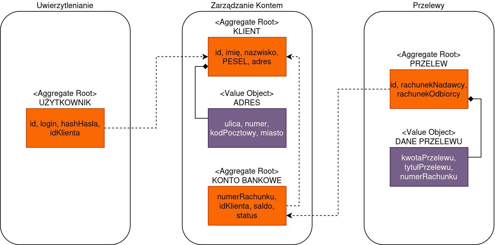

# Zadanie 1 – Domain Driven Design: przelew w systemie bankowym

## Opis zadania

Celem zadania jest zamodelowanie fragmentu aplikacji bankowej zgodnie z zasadami Domain Driven Design. Model obejmuje jeden proces: zalogowany klient zleca przelew krajowy w PLN ze swojego konta. Wyodrębniono trzy konteksty: *Uwierzytelnianie*, *Zarządzanie Kontem* i *Przelewy*, a w nich agregaty, encje i obiekty wartości. Dla każdego obiektu określono akceptowane formaty danych. Dane są walidowane w momencie tworzenia obiektu, więc w systemie nie może istnieć obiekt z niepoprawnymi danymi.

## Model

## Konteksty

| Kontekst | Za co odpowiada | Agregaty |
|---|---|---|
| Uwierzytelnianie | Logowanie użytkownika i ustalenie, którym klientem jest. | `Użytkownik` |
| Zarządzanie Kontem | Dane klienta, rachunki i ich saldo. | `Klient`, `KontoBankowe` |
| Przelewy | Przyjęcie zlecenia przelewu i śledzenie jego statusu. | `Przelew` |

## Encje i obiekty wartości

| Element | Rodzaj | Atrybuty | Reguły |
|---|---|---|---|
| `Użytkownik` | Encja (korzeń agregatu) | `id`, `login`, `hashHasła`, `idKlienta` | Hasło przechowywane tylko jako hash. Po 5 nieudanych logowaniach konto jest czasowo blokowane. |
| `Klient` | Encja (korzeń agregatu) | `id`, `imię`, `nazwisko`, `pesel`, `adres` | PESEL jest unikalny i nie może zostać zmieniony. |
| `KontoBankowe` | Encja (korzeń agregatu) | `numerRachunku`, `idKlienta`, `saldo`, `status` | Saldo nie może spaść poniżej 0. Konto zablokowane nie może być obciążane. |
| `Przelew` | Encja (korzeń agregatu) | `id`, `rachunekNadawcy`, `rachunekOdbiorcy`, `kwota`, `tytuł`, `status`, `data` | Rachunek nadawcy ≠ rachunek odbiorcy. Status: `UTWORZONY` → `ZREALIZOWANY` lub `ODRZUCONY`. |
| `Adres` | Obiekt wartości | `ulica`, `numer`, `kodPocztowy`, `miasto` | Niezmienny – zmiana adresu to zastąpienie całego obiektu. |
| `NumerRachunku`, `KwotaPrzelewu`, `TytułPrzelewu` | Obiekty wartości | patrz tabela niżej | Niezmienne, walidowane przy tworzeniu. |

## Przyjęte założenia – formaty danych

Wszystkie pola tekstowe są sprawdzane według listy dozwolonych znaków i nie przyjmują znaków `<` ani `>`, co zapobiega m.in. wstrzyknięciu kodu (XSS).

| Atrybut | Format | Przykład poprawny | Przykład odrzucany |
|---|---|---|---|
| `id` | UUID, nadawany przez system | `3f6c2b1e-9a4d-4c7e-8f21-0b5d7e9a1c34` | `1` |
| `login` | 6–32 znaki: małe litery, cyfry, `.`, `_`, `-` | `jan.kowalski` | `jk`, `` |
| `status` | wartość z ustalonej listy | `UTWORZONY` | `cokolwiek` |

## Operacje między kontekstami

1. **Logowanie** (Uwierzytelnianie) – użytkownik podaje login i hasło; w wyniku sesja zawiera `idKlienta`.
2. **Zlecenie przelewu** (Przelewy) – tworzony jest `Przelew` w stanie `UTWORZONY`. `idKlienta` brany jest z sesji, nie z formularza; sprawdzane jest, czy rachunek nadawcy należy do tego klienta.
3. **Obciążenie konta** (Zarządzanie Kontem) – jeśli saldo wystarcza, konto nadawcy jest obciążane, a przelew przechodzi w `ZREALIZOWANY`; w przeciwnym razie w `ODRZUCONY`.
4. Konteksty odwołują się do siebie wyłącznie przez identyfikatory (`idKlienta`, `numerRachunku`), a nie przez bezpośrednie referencje do obiektów.
